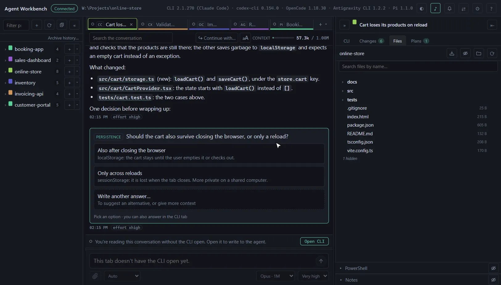
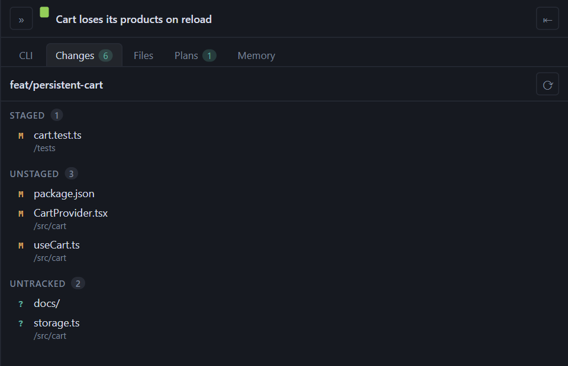
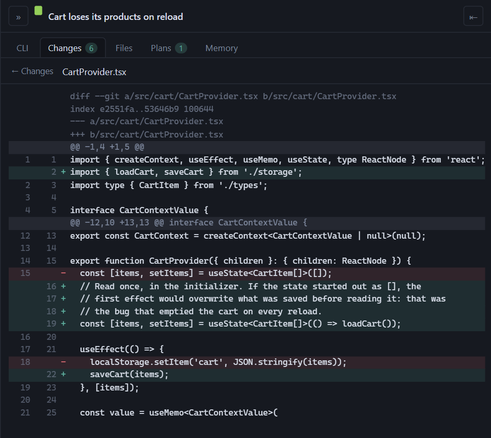
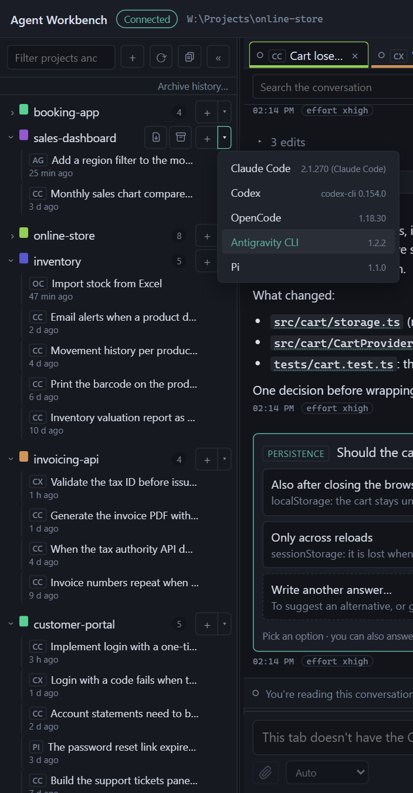
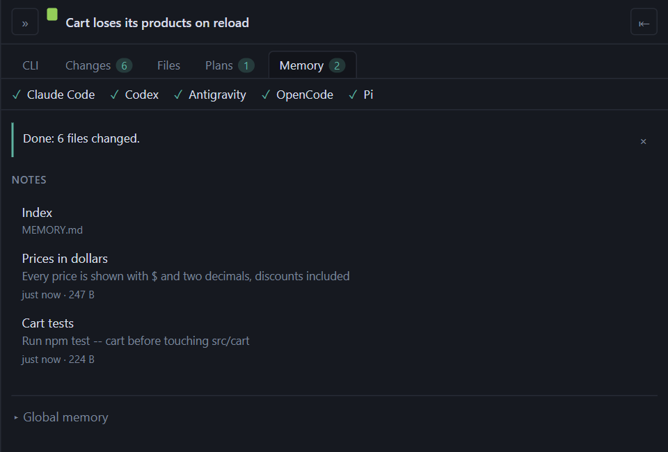
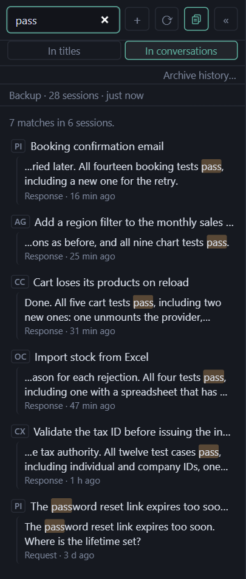
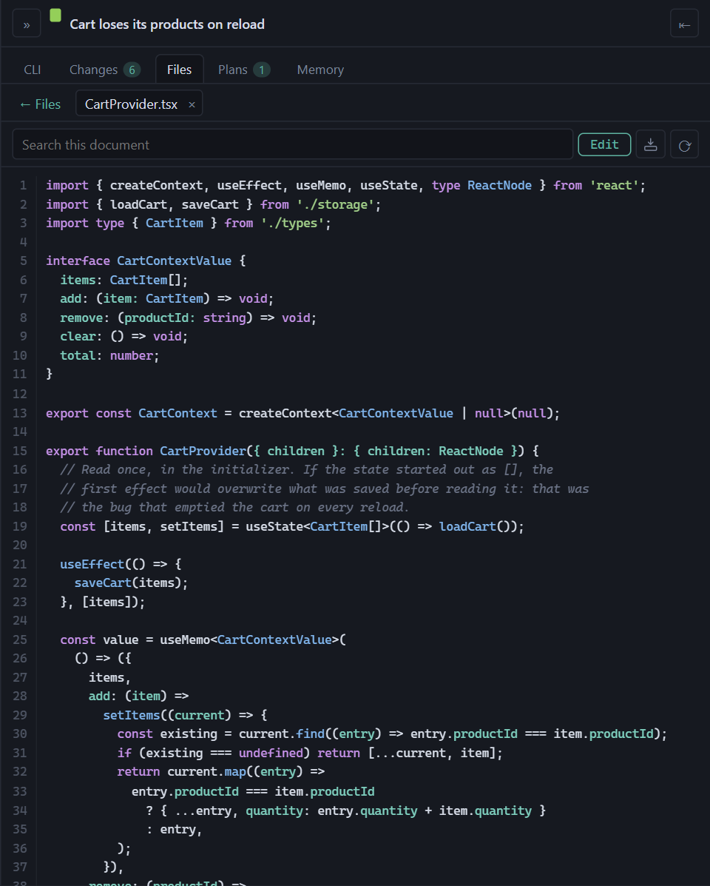

# Agent Workbench

[](https://www.npmjs.com/package/agent-workbench)
[](https://github.com/cvelasquez/agent-workbench/actions/workflows/ci.yml)
[](LICENSE)
[](https://github.com/hesreallyhim/awesome-claude-code)

**English** · [Español](README.es.md) · [简体中文](README.zh-CN.md) · [日本語](README.ja.md) · [Português (Brasil)](README.pt-BR.md) · [Русский](README.ru.md) · [한국어](README.ko.md) · [Français](README.fr.md) · [Deutsch](README.de.md)

**A visual workbench for the coding agents you already use: the Claude Code,
Codex, OpenCode, Antigravity and Pi CLIs.** It runs on your computer and opens
in your browser. It uses the CLIs you already have installed and logged in, never
touches your credentials, and makes no network calls of its own.

```bash
npx agent-workbench
```



## How it works

Agent Workbench doesn't talk to any AI service. It starts the CLI you already
have —`claude`, `codex`, `opencode`, `agy` or `pi`— inside a real terminal, and
adds around it what a terminal alone doesn't give you: tabs, your past
conversations, the conversation as easy-to-read cards, a context meter, the
files that changed and a file tree.

The terminal is still the terminal: everything you type goes straight to the
CLI.

---

## What you get

| | |
|---|---|
| **Tabs** | Several agents at once, from any CLI, each in its own folder. A dot on each tab tells you whether the agent is working, idle or waiting for you. Reloading the page doesn't stop anything: the CLIs run on the server, not in the browser. |
| **Fast start** | When you open the app, your tabs come back **asleep**: you can read them in full, and no CLI starts until you click **Open CLI**. |
| **History** | Your projects and past conversations in the sidebar, from every CLI, with a filter. Click one to pick it up where you left it, with its CLI. Archive old sessions or a whole project to tidy up: nothing is deleted, and it can be undone. |
| **Conversation** | The messages as cards, live, with tool calls folded. Older messages load as you scroll up. Search, copy any message or code block, and jump back to your previous message (↑) or to the end (↓). A row at the bottom says when your message reached the CLI and whether the agent is still working. Depending on the CLI, you can answer the agent's questions right there. A file of the project that the agent names opens in the Files tab with one click. With Claude Code, a message you stop before the agent starts comes back to the box so you can fix it, and **↩** on a message goes back to before it: the conversation and, if you want, the code. A message you send while the agent works waits at the end, marked as queued; depending on the CLI, **Force send now** makes the agent read it right away. |
| **Message box** | Room to write, paste images, attach files, and long pasted text kept as a tidy chip. What you're typing survives closing the app, and shows up live in every open window. Shift+Enter continues a numbered or bulleted list. |
| **Context meter** | How much of the model's context window the conversation is using. Tokens, never money. |
| **Changes** | The branch, the changed files and their diff. **Orchestrates agents in parallel**: open the project on a new branch, in its own folder, and several agents work at once without stepping on each other's changes. Changes shows every branch: what isn't committed yet, how many commits it has and whether it's merged. |
| **Files** | The project's file tree, with search and a preview with syntax highlighting. Open several files at once, each in its own tab; Markdown files open formatted. One click puts a file's path in your message. Edit a text file, a `.env` for instance, and save it right there: if the agent changed it while you were editing, nothing is overwritten, and you move your changes to the new version. |
| **Plans** | The plans and `.md` documents the conversation wrote, rendered. One click puts a document's path in your message. |
| **Notes** | A scratchpad next to the conversation, images included. With Claude Code, one click sends a note to a new conversation. |
| **Console** | Your system's terminal at the bottom, in the project's folder: PowerShell, cmd or Git Bash on Windows; bash or zsh on macOS and Linux. |
| **Continue with…** | With more than one CLI, continue a conversation with another one in the same folder. The new agent starts from a transcript of the last turns. |
| **Notifications** | A sound, and optional system notifications, when an agent finishes or is waiting for you. |
| **Settings** | ⚙ in the header: the language, the terminal's theme, which panels show, which console opens and which CLIs the app uses. |
| **Nine languages** | English, Español, 简体中文, 日本語, Português (Brasil), Русский, 한국어, Français and Deutsch. It follows your browser's language. |
| **Theme** | Light, dark or the system's. The terminal stays dark by default, so the CLIs' colors stay readable. |

Optional, and off by default: [shared memory](#shared-memory-between-clis)
between CLIs, a [backup](#backup-of-your-history) of your history,
[remote access](#remote-access-over-ssh) from another computer or a phone, and
an [Android app](#the-android-app).

<p>
  
  
</p>

### With more than one CLI

Each session and each tab shows a small badge with its CLI, and the `+` for a
new tab lets you pick which one to open. With a single CLI you see none of
this.



**Not every CLI shares the same information**, so a few features depend on the
CLI:

| | Claude Code | Codex | OpenCode | Antigravity CLI | Pi |
|---|:---:|:---:|:---:|:---:|:---:|
| Tab dot: working, idle, waiting for you | ✓ | — | ✓ ¹ | ✓ ² | ✓ |
| Answer the agent's questions from the conversation | ✓ | — | ✓ ¹ | — | — |
| Context meter | ✓ | ✓ | ✓ | ✓ ² | ✓ |
| Mode and model pickers | ✓ | — | — | ✓ | ✓ ³ |
| Paste images | ✓ | ✓ | ✓ | — | ✓ ³ |
| Plans tab | ✓ | — | — | — | — |
| Send a note to a new conversation | ✓ | — | — | — | — |

The CLI's own terminal is always there for the rest: where there's a "—",
questions, for example, are answered in it.

¹ With OpenCode, the app starts a local OpenCode server to get this
([details](#your-data-and-security)).
² Only if you set up its status line
([how](#antigravity-cli-status-and-context-meter)).
³ Pi has no permission modes: its pickers are the model and the thinking level.
And it doesn't attach what you paste: an image travels as a file path that the
model opens itself.

---

## Requirements

- **Node.js 20 or later.** To see OpenCode's history and Antigravity CLI's
  conversation titles, **22.13 or later**: they're read with the SQLite built
  into Node since that version. With an older one, everything else works.
- **git**, for the Changes panel. Everything else works without it.
- **At least one CLI**, installed and logged in:

| CLI | Command | How to install |
|---|---|---|
| Claude Code | `claude` | [installation guide](https://docs.claude.com/en/docs/claude-code/setup) |
| Codex | `codex` | [guide](https://learn.chatgpt.com/docs/codex/cli) |
| OpenCode | `opencode` | [documentation](https://opencode.ai/docs/) |
| Antigravity CLI | `agy` | [guide](https://antigravity.google/docs/cli/getting-started) |
| Pi | `pi` | [pi.dev](https://pi.dev) |

Agent Workbench doesn't include or download any CLI: it finds the ones in your
`PATH`. If there are none, it tells you so and doesn't open sessions.

**Platforms.** Built and used every day on Windows 11 with PowerShell. On macOS
and Linux, every change is installed and started automatically, but they get
less daily use: reports are welcome. On Linux, installing compiles the terminal
module, so you need `python3`, `make` and a C++ compiler (`build-essential` on
Debian and Ubuntu).

---

## Install and start

```bash
npm install -g agent-workbench
```

Then, from the folder of the project you want to work on:

```bash
agent-workbench
```

It opens your browser at an address like this one:

```
  URL          http://127.0.0.1:52341/?token=…
```

That address is the only way in: the token changes on every start, and the app
only listens on your own computer (`127.0.0.1`).

To try it once without installing: `npx agent-workbench`. It downloads about
60 MB the first time, mostly the terminal's native module. For everyday use,
the global install is better.

---

## Keyboard shortcuts

| Keys | Action |
|---|---|
| `Alt+T` | New tab |
| `Alt+W` | Close the tab |
| `Alt+←` / `Alt+→` (or `Alt+PgUp` / `Alt+PgDn`) | Previous / next tab |
| `Alt+P` | Show or hide the right panel |
| `Shift+Tab`, outside the terminal | Back to the previous tab |

The `?` button in the header lists them all, along with the active CLI's own
shortcuts. They use `Alt` because the browser keeps `Ctrl+T`, `Ctrl+W` and
`Ctrl+Tab` for its own tabs and never passes them to the page.

Every other key —`Esc`, `Ctrl+C`, `Ctrl+R`, `Ctrl+O`, the arrows, `Alt+V` to
paste images— reaches the CLI untouched. `Ctrl+V` too: what it does there is up
to the CLI. Only in the console at the bottom, on Windows, `Ctrl+V` pastes text,
as in Windows Terminal.

---

## Optional extras

### Shared memory between CLIs

Each CLI keeps what it learns about a project in its own place, and the others
can't see it. The **Memory** tab sets up one memory for all of them: notes in the
project's `.agents/memory/` folder, which every CLI reads and writes —from here
or from its own terminal— through `AGENTS.md` and `CLAUDE.md`. The tab is hidden
at first: show it from ⚙ Settings.

**Preview changes** shows, file by file, what would be written, and nothing is
touched until you confirm. Setting it up imports the memory Claude Code already
had for that project. The app doesn't edit each CLI's global settings: it gives
you the snippet to paste yourself.



### Backup of your history

Each CLI owns its history, and it can change its format, prune it, or be
uninstalled. The backup keeps a copy of your conversations —messages, tool
calls and results, images, and each project's memory— in a folder of yours, in
files you can read without the app.

**It's off by default.** Open it with the backup button at the top of the
projects sidebar, or from ⚙ Settings. **Measure** tells you how much space it
would take per CLI, without writing anything, and **Turn on** starts it. From
then on it copies everything in the sidebar that isn't archived, and copies a
conversation again a minute after it stops changing. It never deletes anything
from that folder.

With the backup on:

- Conversations a CLI no longer has stay in the sidebar, marked as backup, and
  open as Markdown.
- Any project can be exported to Markdown.
- With more than one CLI, the sidebar filter can search **In conversations**:
  the text of everything copied, from every CLI.



By default it lives in the app's configuration folder
(`%APPDATA%\agent-workbench\vault` on Windows). **Change folder…** copies it to
another one —a synced folder, another drive— without overwriting anything, and
leaves the old one as it was. If you put it in a synced folder or a repository,
your conversations go with it.

<details>
<summary>Importing history from Gemini CLI and the Antigravity IDE</summary>

Two one-time importers bring in history from tools the app doesn't read. They
run from the source code ([below](#from-source)) and **write nothing without
`--write`**: without it, they only tell you what they would import.

- `pnpm vault:import gemini-cli [--cwd <folder>]` — the chats left over from
  Gemini CLI. `--cwd` is the folder where you used it, to file them under that
  project.
- `pnpm vault:import antigravity-ide --workspace <folder>` — what can be read
  from the Antigravity IDE conversations in that folder: each one's summary and
  its `.md` documents. The conversation itself is encrypted, so it's marked as
  partial history.

</details>

### Antigravity CLI: status and context meter

Antigravity CLI only tells whether it's working or waiting for you, and how
many tokens it has used, through its *status line*. Without it, its tabs work
normally, but the tab's dot says the status is unknown and the meter stays
empty. To turn it on:

1. Open an Antigravity tab and click **Configure**, next to the meter.
2. Copy the line it shows and add it to what
   `~/.gemini/antigravity-cli/settings.json` already has. The app doesn't edit
   that file: you do.
3. Within a couple of seconds, or with **Check**, the dialog says
   **Configured**.

The line runs a small script kept in the app's own folder. It saves only each
conversation's status, mode, model and tokens —not your email, quota, plan or
cost, which the CLI also passes to it— and prints nothing, so the CLI's own
status line stays as it was. Once set, it runs on **every** `agy` session,
including the ones you open outside the app, and it needs `node` in the
`PATH`.

### Remote access over SSH

Leave Agent Workbench running on one computer and use it from another one on
your network, in its browser, with no CLI installed there. **The app is never
opened to the network**: it still listens only on `127.0.0.1`, and the other
computer reaches it through an SSH tunnel. The tunnel is also what makes it
work: through it the other browser sees the app as `localhost`, which browsers
require for the clipboard and notifications. **It's off by default.**

**1. On the computer that runs the app, once: turn on its SSH server.** It's a
system change that needs administrator rights, so the app doesn't do it for
you.

- **Windows 10/11** — in PowerShell *as administrator*. The first line downloads
  and installs the server and takes a few minutes: wait until the prompt comes
  back.

  ```powershell
  Add-WindowsCapability -Online -Name OpenSSH.Server~~~~0.0.1.0
  Start-Service sshd
  Set-Service -Name sshd -StartupType Automatic
  ```

- **macOS** — System Settings → General → Sharing → **Remote Login**.
- **Linux** — install and turn on your distribution's OpenSSH server. On Debian
  or Ubuntu:

  ```bash
  sudo apt install openssh-server
  sudo systemctl enable --now ssh
  ```

**2. In the app: ⇄ in the header → Turn on remote access, then restart Agent
Workbench.** The tunnel needs a port that doesn't change, so the app uses a
fixed one (24837 by default; you can change it), and the port is chosen at
startup. Restarting closes the open CLIs; your tabs come back asleep. Turning
it *off* works right away.

**3. On the other computer, each time: open the tunnel.** The dialog shows the
command ready to copy:

```
ssh -N -L 24837:127.0.0.1:24837 you@your-computer
```

Leave it running, and **use the same port on both ends**: with a different
local port the app answers 403. Adding
`-o ServerAliveInterval=30 -o ExitOnForwardFailure=yes` makes the tunnel notice
a dropped Wi‑Fi instead of hanging. On Windows you can save the command in a
`.cmd` file and double-click it.

**4. Pair that computer, once.** In the dialog, **Pair a device** gives you an
address with a one-time code, like `http://localhost:24837/?pair=K7QM-X2RD`.
Open it in the other computer's browser within five minutes. From then on, that
browser just opens `http://localhost:24837`, even after the app restarts. The
dialog lists the paired devices, and **Revoke** cuts one off at once.

A paired device can use the whole app, except managing remote access and the
few things that would open a window on the host computer, like *Open with the
default app*. A **Remote** badge in the header shows it. Keep in mind that the
app includes a console and launches agents, so a paired device can run commands
on your computer, just as you can. **Pair only devices that are yours.**

**On a phone or tablet.** Through the same tunnel, a phone's browser gets a
one-column layout: the projects sidebar slides in from the side, the tabs sit
in the header, and a strip switches between the conversation, the CLI, changes,
files and the rest. It appears on any window narrower than 768 px. On a touch
screen, Enter in the message box starts a new line (the send button sends), and
dragging a finger over a terminal scrolls it.

<details>
<summary>A safer SSH key, only good for the tunnel (recommended)</summary>

The SSH login is your user's on that computer, so a password or key that opens
the tunnel also opens a full terminal there. You can create a key that is only
good for the tunnel: generate one on the other computer
(`ssh-keygen -t ed25519`) and add its public half to `authorized_keys` on the
computer that runs the app, with these options in front:

```
restrict,port-forwarding,permitopen="127.0.0.1:24837",command="exit" ssh-ed25519 AAAA… other-computer
```

`restrict` alone still lets the key run commands; `command="exit"` is what
closes that door, and the tunnel never asks for a command. On Windows, if your
user is an administrator, that file is
`C:\ProgramData\ssh\administrators_authorized_keys`, and it must be writable
only by Administrators and SYSTEM; otherwise it's
`%USERPROFILE%\.ssh\authorized_keys`. To check it, try
`ssh you@your-computer whoami` with that key: it should print nothing and end
at once, while the `-N -L` tunnel keeps working.

</details>

### The Android app

An app for Android 10 and later opens the tunnel for you and shows the same
interface, served by your computer, in the phone layout. It stays connected in
the background and notifies you when an agent finishes or is waiting for you,
even with the screen off; tapping a notification opens that tab. When the Wi‑Fi
comes back, it reconnects on its own.

It needs remote access on and the computer's SSH server running (steps 1 and 2
above). Get it on
[Google Play](https://play.google.com/store/apps/details?id=io.github.cvelasquez.agentworkbench),
or build it yourself from [`android/`](android/) as
[`CONTRIBUTING.md`](CONTRIBUTING.md#the-android-app) explains.

**Pairing, once:**

1. In the ⇄ dialog, choose **Pair a phone**. It shows a line to paste in a
   terminal on this computer, and a QR code. On Windows, if your user is an
   administrator, the line goes in PowerShell *as administrator*; the dialog
   tells you.
2. Paste the line. It authorizes the phone's key for the tunnel only: with it,
   the phone reaches the app and nothing else — no terminal, no commands.
3. Scan the QR code with the app. The code works once and for five minutes, and
   the dialog has to stay open until the phone connects.

The QR code carries the phone's private SSH key. Your computer keeps it only in
memory until the phone uses it and never writes it to disk: **don't share a
picture of that QR code**. The phone remembers your computer's SSH fingerprint
on the first connection, and if it ever changes, it refuses to connect and tells
you.

**To remove a phone**, **Revoke** it in the dialog and delete its line from
`authorized_keys` (it ends in `agent-workbench-phone`). On the phone,
**Settings → Forget this computer** deletes its key and its credential.

If notifications arrive late while the phone sits idle, let the app run without
battery restrictions: **Settings → Open the app's battery settings**. What the
app keeps on the phone and the permissions it asks for are in
[`PRIVACY.md`](PRIVACY.md).

---

## Your data and security

- **Agent Workbench sends nothing anywhere.** No telemetry, no analytics, no
  network calls of its own. The Android app talks only to your computer.
- **Each CLI still does on its own what it would do if you opened it by hand:**
  it talks to its AI provider, and it may check for updates or send its own
  usage data. Agent Workbench doesn't add anything to that, and it doesn't turn
  it off either: it doesn't change any CLI's settings. What each CLI sends is
  in its own documentation.
- **It never touches your credentials.** There's no login screen: if a CLI asks
  you to log in, you do it in its own terminal, and the app doesn't even notice.
- **It reads the CLIs' history and writes nothing in their folders.** The table
  below lists what it reads and what it never opens.
- **It writes only in its own folders**, plus three things in your projects:
  the shared memory, only if you confirm it; a file you edit and save yourself
  in the Files tab; and the separate branches you open, each in its own folder
  next to the project, with the notes that go back to the main folder when you
  remove one.
- **The server listens only on your computer** (`127.0.0.1`), on a random port,
  with a new random token on every start, and it rejects requests coming from
  other web pages. Remote access doesn't change that: the port becomes a fixed
  one, still on `127.0.0.1`, and SSH —which you turn on and control— does the
  rest.
- **Git: the app never commits, pushes or rewrites history.** It runs three git
  commands that write, each after a confirmation that shows it:
  `git worktree add` to open a branch in its own folder, `git worktree remove`
  (never with `--force`) and `git branch -d` (only for a branch the app created
  and that is already merged). The agents make the commits, in their terminal.

| CLI | What it reads | What it never opens |
|---|---|---|
| Claude Code | From `~/.claude/`: `projects/` (the history, and each project's memory, to import it), `sessions/` (whether the CLI is waiting for you) and `plans/`. For the Plans tab, also the `.md` files the conversation wrote in the project or in that session's temp folder — **only the ones named by the conversation you're viewing**, without browsing any folder | `.credentials.json` or any token |
| Codex | From `~/.codex/` (or `CODEX_HOME`): `sessions/` and `archived_sessions/` | `auth.json`, `config.toml` or its `*.sqlite` databases |
| OpenCode | Its `opencode.db` database, opened read-only, and from it only the sessions, messages and parts; and its model catalog, for the context window size | `auth.json`, `opencode.json`, or the accounts, credentials, permissions and shared-sessions tables |
| Antigravity CLI | From `~/.gemini/antigravity-cli/`: each conversation's transcripts, `history.jsonl`, the last conversation of each folder, the model and status line from `settings.json`, and a temporary **copy** of its conversation index; from `~/.gemini/config/projects/`, each project's folder | Its MCP configuration, its entry in the system keychain, the contents of `conversations/`, and `~/.gemini/antigravity/`, which is its IDE |
| Pi | From `~/.pi/agent/` (or `PI_CODING_AGENT_DIR`): the sessions in `sessions/`, and `models-store.json`, its model catalog, for the context window size and the model picker. From the installed Pi package: its `package.json`, to know the version without running Pi, and its built-in model list | `auth.json`, `models.json`, `settings.json` or its MCP configuration |

The [backup importers](#backup-of-your-history), when you run them, also read
what their section says. The full list, file by file, is in
[`ARCHITECTURE.md`](ARCHITECTURE.md#4-what-is-read-from-each-cli).

<details>
<summary>The fine print: footprints, environment variables and what the app writes</summary>

**Three footprints worth knowing about:**

- **Reading the OpenCode database** does what SQLite does with any reader: it
  creates its `-wal` and `-shm` files if they're missing and updates the date of
  `-shm`. The app never runs an OpenCode command to read it.
- **If an Antigravity tab's own log doesn't show up**, the app reads the CLI's
  `log/cli-*.log` files, which contain your messages and the account's email,
  only to find the conversation's id, and without keeping any line.
- **With OpenCode, the app runs a local OpenCode server** (`opencode serve`):
  just one, from when you open the first OpenCode tab until five minutes after
  you close the last one, or until you close the app. It listens on
  `127.0.0.1`, on a random port, with a different password on every start, even
  if your OpenCode configuration says otherwise. The app only asks it for the
  sessions' status, pending permissions and questions, to create a session, to
  answer a question and to stop a session: nothing about your configuration or
  your accounts.

**Environment variables.** The CLIs inherit your environment as it is, with no
login variables added. Two exceptions: the app **removes**
`CLAUDE_CODE_CHILD_SESSION` —which turns off history saving— and tells you with
a banner when it does; and it **adds** one variable to the OpenCode server,
`OPENCODE_SERVER_PASSWORD`, with that per-start password. It isn't any account's
password, and it doesn't reach any tab: each OpenCode tab gets it on its command
line (`attach --password`), where other programs running as your user can see
it. It only works for that server and stops working when you close the app.

**What Pi sends on its own.** When it starts, Pi checks pi.dev for its latest
version and its model catalog, and it reports each install and update there.
You turn that report off in Pi, not here: `enableInstallTelemetry: false` in
Pi's settings, or the `PI_TELEMETRY=0` environment variable.

**What the app writes:**

- **In its own configuration folder:** the open tabs, the index cache, the
  notes, the archived sessions, unsent messages, the Antigravity status line
  script and, if you turn it on, the backup (or in the folder you choose). With
  remote access on, also the list of paired devices: a name, two dates and a
  hash of each one's credential — never the credential itself.
- **In the temp folder:** the images and files you paste or attach; each
  Antigravity tab's log, which contains your messages, readable only by you and
  deleted on the first start after it's 24 hours old; and the transcript of a
  conversation you continue with another CLI, deleted when you close that tab
  or after 24 hours.
- **In your projects, two things only:** the shared memory, only if you
  confirm, limited to `.agents/memory/`, to what's between its markers in
  `AGENTS.md` and `CLAUDE.md`, and to a few lines at the end of `.gitignore`;
  and a file you edit in the Files tab, when you save it. That only replaces the
  contents of a file that already exists: nothing is created, renamed or
  deleted, and nothing is written in a CLI's folder.

</details>



---

## Troubleshooting

**"The "claude" command wasn't found in the PATH", followed by "Also works
with: …"** — the app didn't find any of the CLIs. Check with
`where claude` on Windows (`which claude` elsewhere), and the same with `codex`,
`opencode`, `agy` or `pi`. CLIs are looked up at startup: if you installed one
while the app was open, restart it.

**Pi is installed, but the app doesn't see it.** The app doesn't run `pi` to
find it: it reads the version from Pi's package, next to the command. That
works when Pi was installed with npm or with the pi.dev installer; a standalone
`pi` binary isn't recognized. And if another program called `pi` comes first
in your `PATH`, the app ignores it and says so in its console.

**In a Pi tab, the message box says the CLI is waiting for an answer.** Pi is
asking whether to trust the project folder. Answer it in the **CLI** tab: the
app never answers that for you.

**OpenCode's history doesn't show up.** Look at the `History` line when the app
starts. If it says that Node version doesn't include `node:sqlite`, update Node
to 22.13 or later. If there's no such line, it didn't find the database: it's at
`~/.local/share/opencode/opencode.db`, or wherever `OPENCODE_DB` or
`XDG_DATA_HOME` points.

**An OpenCode tab won't open: "Couldn't start the OpenCode server".** The reason
comes after the colon. If it isn't clear, open `opencode` in a regular terminal:
if it doesn't start there either, the problem is that OpenCode installation.

**An OpenCode tab says the server closed.** **Relaunch**, in the same bar,
starts another server and reconnects the tab to the same session.

**An Antigravity tab doesn't show its status or the meter.** Look at the
`Status line` entry when the app starts, under the CLI. If it says it isn't
configured, or that there's another one, follow
[these steps](#antigravity-cli-status-and-context-meter). If you configured it
and the CLI's terminal shows `Statusline Error`, `node` is most likely not in
that session's `PATH`.

**`node-pty` doesn't compile on install.** It's the terminal's native module. It
usually downloads a ready-made binary; if your Node and platform don't have one,
it has to be compiled:

- **Windows:** Visual Studio Build Tools with the *Desktop development with C++*
  workload, and Python 3. (`windows-build-tools` from npm is no longer
  maintained.)
- **macOS:** `xcode-select --install`.
- **Linux:** `build-essential` and `python3`.

**The terminal stays blank.** The default renderer is canvas on purpose: with
WebGL the tab freezes on Windows 11 + Chrome. To try WebGL anyway, add
`?renderer=webgl` to the address.

**A banner says `CLAUDE_CODE_CHILD_SESSION` was removed.** You started the app
from inside a Claude Code session. That variable turns off history saving, so
the app removes it and lets you know. From a regular terminal you'll never see
this.

**From the other computer, `ssh` can't connect** (it times out or is refused).
The SSH server isn't running on the computer with the app, or something between
the two blocks it. On Windows, check that the Wi‑Fi network is set to
*Private*: the SSH server's firewall rule may not cover *Public* networks. A
work VPN that blocks the local network also cuts it while it's connected. If
`ssh` rejects your user, a Microsoft or work account may need the name of your
user folder (`C:\Users\<name>`) and the account's password, not the PIN.

**From the other computer, the page says "Origin not allowed"** (403). It was
opened by the computer's name or IP address. Open `http://localhost:<port>`,
with the tunnel using the same port on both ends.

**From the other computer, the page says the session token is missing** (401).
That browser isn't paired, it was revoked, or remote access is off. Pair it
again from the ⇄ dialog.

**The ⇄ dialog says the port is busy.** Another program —often a second Agent
Workbench— is using it. Close it and restart, or choose another port.

**The Changes panel says the folder isn't a git repository**, and it is one.
Make sure `git` is in the `PATH`. If the message is a different one, it's git's
own error, word for word.

---

## From source

To work on the app, or if you'd rather not install anything globally:

```bash
corepack enable pnpm
pnpm install
pnpm dev       # with hot reload
```

```bash
pnpm build     # builds the interface once
pnpm start     # serves the built interface
```

**One-click start on Windows:** `pnpm package` builds the interface and leaves
an **`Agent Workbench.cmd`** in the root. Double-click it: it installs whatever
is missing, builds if needed and opens the browser. It's a twenty-line text
file you can read before running it.

---

## How it's built

A pnpm monorepo, TypeScript throughout.

```
packages/
  server/    Node, Express, ws, node-pty, chokidar — serves the interface and runs the terminals
    src/agents/   one adapter per CLI: the only part of the server that knows each one
  web/       Vite, React, xterm.js, highlight.js
  shared/    the protocol types, with no `any` at the edges
android/     the Android app, in Kotlin: the SSH tunnel, the interface, the notifications
```

Two decisions shape the rest. **The terminals live on the server and the
browser is just a window onto them**: closing or reloading the page doesn't
kill a working session. And **the generic server doesn't name any CLI**: what it
knows about each one —where it keeps things, how it's launched, what is read
and what is never opened— lives in that CLI's adapter, and the interface shows
each control based on what that CLI declares.

[`ARCHITECTURE.md`](ARCHITECTURE.md) has the hard rules and the code map,
[`CONTRIBUTING.md`](CONTRIBUTING.md) how to work on the repository,
[`SECURITY.md`](SECURITY.md) how to report a vulnerability,
[`PRIVACY.md`](PRIVACY.md) what is collected (nothing), and
[`CHANGELOG.md`](CHANGELOG.md) what changed in each version. Code comments are
in Spanish. The screenshots in this README come from `pnpm demo:shots`, on
made-up data.

---

## Support the project

If Agent Workbench is useful to you, consider supporting it:
[Buy Me a Coffee](https://buymeacoffee.com/cvelasquez). The app suggests it
once per version, in a strip you can close, and never again until the next one.

---

## License

MIT. See [`LICENSE`](LICENSE).

Agent Workbench is an independent project. It works with the Claude Code,
Codex, OpenCode, Antigravity and Pi CLIs, but it is not affiliated with or
endorsed by Anthropic, OpenAI, the OpenCode authors, Google or Earendil.
