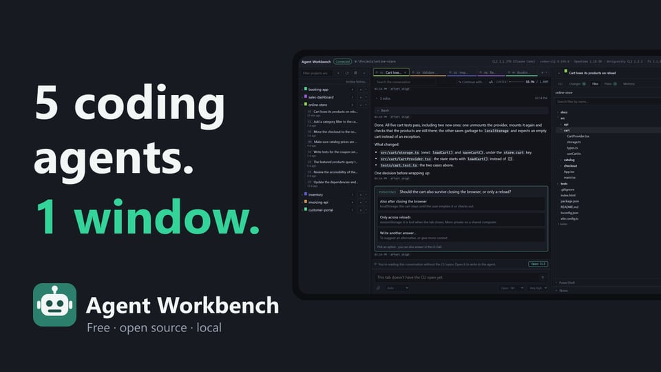

# Agent Workbench

[](https://www.npmjs.com/package/agent-workbench)
[](https://github.com/cvelasquez/agent-workbench/actions/workflows/ci.yml)
[](LICENSE)
[](https://github.com/hesreallyhim/awesome-claude-code)

[English](README.md) · [Español](README.es.md) · **简体中文** · [日本語](README.ja.md) · [Português (Brasil)](README.pt-BR.md) · [Русский](README.ru.md) · [한국어](README.ko.md) · [Français](README.fr.md) · [Deutsch](README.de.md)

**为你已经在用的编程代理 CLI 打造的可视化工作台：Claude Code、Codex、OpenCode、Antigravity 和 Pi CLI**。它运行在你的电脑上，在浏览器中打开。它使用你已经安装并登录好的 CLI，从不碰你的凭据，自己也不发起任何网络请求。

```bash
npx agent-workbench
```


<a href="https://youtu.be/C0Iea1cKQ7o"></a>

▶ **[视频教程](https://youtu.be/C0Iea1cKQ7o)**：6 分钟看完整个应用，带章节，可直接跳到需要的部分（英文）。

## 工作原理

Agent Workbench 不和任何 AI 服务通信。它在一个真正的终端里启动你已有的 CLI（`claude`、`codex`、`opencode`、`agy` 或 `pi`），并在周围补上单靠终端给不了的东西：标签页、你的历史对话、以易读卡片呈现的对话、上下文用量条、改动过的文件，以及文件树。

终端依然是终端：你输入的一切都会直接传给 CLI。

---

## 功能一览

| | |
|---|---|
| **标签页** | 同时运行多个代理，可以来自任意 CLI，各自在自己的文件夹中。每个标签页上的圆点会告诉你代理是在工作、空闲，还是在等你。刷新页面不会中断任何东西：CLI 运行在服务器上，而不是浏览器里。 |
| **快速启动** | 打开应用时，标签页会以**休眠**状态恢复：可以完整查看内容，在你点击**打开 CLI** 之前，不会启动任何 CLI。 |
| **历史记录** | 侧边栏列出所有 CLI 的项目和历史对话，可以筛选。点击一个对话，就会用它原来的 CLI 从上次停下的地方继续。可以归档旧会话或整个项目来保持整洁：不会删除任何内容，而且可以撤销。 |
| **对话** | 消息以卡片形式实时显示，工具调用折叠显示。向上滚动时会加载更早的消息。可以搜索，复制任意消息或代码块，也可以跳回你的上一条消息（↑）或跳到末尾（↓）。底部有一行会告诉你消息何时送达 CLI，以及代理是否仍在工作。视 CLI 而定，你可以直接在这里回答代理的提问。代理提到的项目文件，点一下就能在“文件”标签页中打开；文件夹则在系统文件管理器中打开。使用 Claude Code 时，在代理开始前停下的消息会回到输入框，方便修改；在消息上点 **↩** 可以回到这条消息之前：对话，以及（如果你愿意）代码。代理工作时发送的消息会排在末尾，标为排队中；视 CLI 而定，**立即强制发送** 可以让代理马上读到它，点击**编辑**（或在空输入框中按 ↑）则会把它放回输入框，方便修改。 |
| **输入框** | 有足够的空间书写，可以粘贴图片、附加文件；粘贴的长文本会折叠成一个整洁的小块。正在输入的内容在关闭应用后仍会保留，并实时同步到所有打开的窗口。Shift+Enter 可以续写编号列表或项目符号列表。时钟按钮可以让你写好的内容在你选定的日期和时间，自动发送到同一个对话中；需要先在 ⚙ 设置中开启（Antigravity CLI 需要先配置它的 status line）。 |
| **上下文用量条** | 对话占用了模型上下文窗口的多少。只显示 token，从不显示费用。用量达到 70% 后，点击**压缩**可以让 CLI 压缩对话。使用 Claude Code、Codex 和 Antigravity CLI 时，旁边还会显示你的套餐用量限制已用了多少，以及何时重置。 |
| **更改** | 当前分支、改动的文件和它们的差异。**并行编排多个代理**：在新分支上、用独立的文件夹打开项目，多个代理就能同时工作，互不干扰彼此的改动。已经开始的对话也能连同全部上下文移到新分支（Claude Code、Codex 和 OpenCode）。“更改”会显示每个分支：哪些还没提交、有几个提交、是否已经合并。另一个 CLI 在不改动分支的情况下审查它，你一键就能把它合并到 main。 |
| **文件** | 项目的文件树，支持搜索，预览带语法高亮。可以同时打开多个文件，每个文件一个标签页；Markdown 文件以格式化方式打开。点一下就能把文件路径放进消息。可以直接编辑并保存文本文件，比如 `.env`：如果你编辑时代理改动了这个文件，不会覆盖任何内容，你再把自己的修改移到新版本里。 |
| **计划** | 对话写下的计划和 `.md` 文档，渲染后显示。点一下就能把文档路径放进消息。 |
| **笔记** | 对话旁边的草稿区，也能放图片。点**放入输入框**会把笔记放进输入框，发到你当前的对话；使用 Claude Code 时，点一下也能把它发到一个新对话中。 |
| **控制台** | 底部是你系统自带的终端，位于项目文件夹中：Windows 上是 PowerShell、cmd 或 Git Bash；macOS 和 Linux 上是 bash 或 zsh。 |
| **继续使用…** | 装了多个 CLI 时，可以在同一个文件夹中用另一个 CLI 继续对话。新的代理会从最近几轮的对话记录开始。 |
| **通知** | 代理完成工作或在等你时，会播放提示音，还可以选择显示系统通知。 |
| **设置** | 顶栏中的 ⚙：语言、终端主题、显示哪些面板、打开哪个控制台、应用使用哪些 CLI，以及是否可以定时发送消息。 |
| **九种语言** | English、Español、简体中文、日本語、Português (Brasil)、Русский、한국어、Français 和 Deutsch。界面语言跟随浏览器。 |
| **主题** | 浅色、深色或跟随系统。终端默认保持深色，这样 CLI 的配色才看得清。 |

可选功能，默认关闭：CLI 之间的[共享记忆](#cli-之间的共享记忆)、历史记录的[备份](#历史记录备份)、Claude Code 的[套餐用量限制](#claude-code套餐用量限制)、从另一台电脑或手机[远程访问](#通过-ssh-远程访问)，以及 [Android 应用](#android-应用)。

<p>
  
  
</p>

### 使用多个 CLI 时

每个会话和每个标签页都会显示一个小标记，标明所属的 CLI；新建标签页的 `+` 让你选择要用哪个 CLI 打开。只有一个 CLI 时，这些都不会出现。


**并非每个 CLI 都提供同样的信息**，所以有几项功能取决于所用的 CLI：

| | Claude Code | Codex | OpenCode | Antigravity CLI | Pi |
|---|:---:|:---:|:---:|:---:|:---:|
| 标签页圆点：工作中、空闲、等你回应 | ✓ | — | ✓ ¹ | ✓ ² | ✓ |
| 在对话中回答代理的提问 | ✓ | — | ✓ ¹ | — | — |
| 上下文用量条 | ✓ | ✓ | ✓ | ✓ ² | ✓ |
| 模式和模型选择器 | ✓ | — | — | ✓ | ✓ ³ |
| 粘贴图片 | ✓ | ✓ | ✓ | — | ✓ ³ |
| “计划”标签页 | ✓ | — | — | — | — |
| 把笔记发到新对话 | ✓ | — | — | — | — |

其余的事情，始终可以交给 CLI 自己的终端：例如在标着“—”的地方，提问就在终端里回答。

¹ 使用 OpenCode 时，应用会启动一个本地 OpenCode 服务器来实现这一点（[详情](#你的数据与安全)）。
² 仅在你配置了它的 status line 时可用（[方法](#antigravity-cli状态与上下文用量条)）。
³ Pi 没有权限模式：它的选择器是模型和思考级别。另外，它不会附加你粘贴的内容：图片以文件路径的形式传过去，由模型自己打开。

---

## 系统要求

- **Node.js 20 或更高版本**。要查看 OpenCode 的历史记录和 Antigravity CLI 的对话标题，需要 **22.13 或更高版本**：它们是用 Node 从该版本起内置的 SQLite 读取的。版本较低时，其他功能都能正常使用。
- **git**，用于“更改”面板。没有它，其他功能也都能正常使用。
- **至少一个 CLI**，已安装并已登录：

| CLI | 命令 | 安装方法 |
|---|---|---|
| Claude Code | `claude` | [安装指南](https://docs.claude.com/en/docs/claude-code/setup) |
| Codex | `codex` | [指南](https://learn.chatgpt.com/docs/codex/cli) |
| OpenCode | `opencode` | [文档](https://opencode.ai/docs/) |
| Antigravity CLI | `agy` | [指南](https://antigravity.google/docs/cli/getting-started) |
| Pi | `pi` | [pi.dev](https://pi.dev) |

Agent Workbench 不包含也不会下载任何 CLI：它会在你的 `PATH` 中查找。一个都找不到时，它会告诉你，并且不会打开会话。

**平台**。在 Windows 11（PowerShell）上开发，并且每天都在使用。在 macOS 和 Linux 上，每次改动都会自动安装并启动一遍，但日常使用较少：欢迎反馈问题。在 Linux 上，安装时要编译终端模块，所以需要 `python3`、`make` 和 C++ 编译器（Debian 和 Ubuntu 上是 `build-essential`）。

---

## 安装与启动

```bash
npm install -g agent-workbench
```

然后，在你要处理的项目文件夹中运行：

```bash
agent-workbench
```

它会在浏览器中打开一个类似这样的地址：

```
  URL          http://127.0.0.1:52341/?token=…
```

只有通过这个地址才能进入：token 每次启动都会变，而且应用只在你自己的电脑上监听（`127.0.0.1`）。

不安装、只想试一次：`npx agent-workbench`。第一次会下载大约 60 MB，主要是终端的原生模块。日常使用的话，全局安装更好。

---

## 键盘快捷键

| 按键 | 操作 |
|---|---|
| `Alt+T` | 新建标签页 |
| `Alt+W` | 关闭标签页 |
| `Alt+←` / `Alt+→`（或 `Alt+PgUp` / `Alt+PgDn`） | 上一个 / 下一个标签页 |
| `Alt+P` | 显示或隐藏右侧面板 |
| `Shift+Tab`（焦点在终端外时） | 返回上一个标签页 |

顶栏的 `?` 按钮会列出所有快捷键，以及当前 CLI 自己的快捷键。之所以用 `Alt`，是因为浏览器把 `Ctrl+T`、`Ctrl+W` 和 `Ctrl+Tab` 留给自己的标签页，从不传给页面。

其他所有按键（`Esc`、`Ctrl+C`、`Ctrl+R`、`Ctrl+O`、方向键、用来粘贴图片的 `Alt+V`）都会原样传给 CLI。`Ctrl+V` 也一样：它会做什么，由 CLI 决定。只有在 Windows 上的底部控制台里，`Ctrl+V` 才会粘贴文本，和 Windows Terminal 一样。

---

## 可选功能

### CLI 之间的共享记忆

每个 CLI 都把它对项目的了解存放在自己的地方，其他 CLI 看不到。**记忆**标签页为所有 CLI 建立一份共用的记忆：笔记放在项目的 `.agents/memory/` 文件夹中，每个 CLI 都通过 `AGENTS.md` 和 `CLAUDE.md` 读写它，无论是在这里，还是在 CLI 自己的终端里。这个标签页一开始是隐藏的：可以在 ⚙ 设置中让它显示。

**预览更改**会逐个文件列出将要写入的内容，在你确认之前不会改动任何东西。设置时会导入 Claude Code 为该项目保存的已有记忆。应用不会修改各个 CLI 的全局设置：它只给出片段，由你自己去粘贴。


### 历史记录备份

历史记录归各个 CLI 所有：CLI 可能会改变格式、清理旧记录，也可能被卸载。备份会把你的对话（消息、工具调用及其结果、图片，以及每个项目的记忆）复制一份，放在你自己的文件夹里，文件不用本应用也能读。

**默认关闭**。可以用项目侧边栏顶部的备份按钮打开它，也可以从 ⚙ 设置中打开。**统计**会告诉你每个 CLI 需要占用多少空间，不写入任何内容；**开启**则开始备份。此后，它会复制侧边栏中所有未归档的内容，并在对话停止变化一分钟后再复制一次。它从不删除该文件夹中的任何内容。

开启备份后：

- CLI 已经没有的对话仍会留在侧边栏中，标记为“备份”，并以 Markdown 格式打开。
- 任何项目都可以导出为 Markdown。
- 装了多个 CLI 时，侧边栏的筛选框可以选择**在对话中**搜索：在所有 CLI 已复制的全部内容中查找文本。


默认存放在应用的配置文件夹中（Windows 上是 `%APPDATA%\agent-workbench\vault`）。点击**更改文件夹…**，可以把它复制到另一个文件夹（比如同步文件夹或另一块硬盘），不会覆盖任何内容，原文件夹也保持原样。如果你把它放在同步文件夹或代码仓库中，你的对话也会随之被同步或提交。

<details>
<summary>从 Gemini CLI 和 Antigravity IDE 导入历史记录</summary>

两个一次性导入工具可以导入本应用不读取的工具留下的历史记录。它们从源码运行（见[下文](#从源码运行)），并且**不加 `--write` 就不会写入任何内容**：不加时，只会告诉你会导入什么。

- `pnpm vault:import gemini-cli [--cwd <folder>]`：Gemini CLI 留下的聊天记录。`--cwd` 是你当时使用它的文件夹，用来把这些记录归到那个项目下。
- `pnpm vault:import antigravity-ide --workspace <folder>`：该文件夹中 Antigravity IDE 的对话里能读取的部分，即每个对话的摘要及其 `.md` 文档。对话本身是加密的，所以会标记为“部分”历史记录。

</details>

### Claude Code：套餐用量限制

Claude Code 只通过它的 *status line* 告诉外界你的套餐用量限制（5 小时窗口和每周）用了多少。要在上下文用量条旁边看到它们：

1. 打开一个 Claude Code 标签页，点击用量条旁边的**配置**。
2. 复制它显示的那一行，加到 `~/.claude/settings.json` 的现有内容中。应用不会修改这个文件：需要你自己改。也可以用**复制给代理的请求**，让 AI 代理替你添加。
3. 几秒钟内，或者点击**检查**后，对话框会显示**已配置**。用量限制会随下一次回复出现。

Claude Code 只允许一个 status line，所以这一行会替换你已有的任何其他 status line，而且有了它，CLI 底部会不再显示部分提示，例如“esc to interrupt”。这一行运行的是一个放在应用自己文件夹中的小脚本：它只保存这两个限制和会话的 id，并把它们作为一行简短文字显示在 CLI 底部。它会在**每一个** `claude` 会话中运行，包括你在应用之外打开的会话，并且需要 `PATH` 中有 `node`。Claude Code 只在订阅套餐中提供这些限制，使用 API 密钥时不提供。

Codex 不需要任何设置：它会把用量限制写进自己的历史记录。Antigravity CLI 通过它的 status line 提供这些限制，见下文。OpenCode 和 Pi 不提供这些限制。

### Antigravity CLI：状态与上下文用量条

Antigravity CLI 只通过它的 *status line* 告诉外界自己是在工作还是在等你、用了多少 token，以及你的配额还剩多少。没有它，标签页照常工作，但标签页上的圆点会显示状态未知，用量条也都一直是空的。开启方法：

1. 打开一个 Antigravity 标签页，点击用量条旁边的**配置**。
2. 复制它显示的那一行，加到 `~/.gemini/antigravity-cli/settings.json` 的现有内容中。应用不会修改这个文件：需要你自己改。也可以用**复制给代理的请求**，让 AI 代理替你添加。
3. 几秒钟内，或者点击**检查**后，对话框会显示**已配置**。

这一行会运行一个放在应用自己文件夹中的小脚本。它只保存每个对话的状态、模式、模型和 token 用量，以及你的配额还剩多少、何时重置。CLI 也会把你的邮箱、套餐和费用传给它，但这些都不保存；它也不输出任何内容，所以 CLI 自己的 status line 保持原样。配置后，它会在**每一个** `agy` 会话中运行，包括你在应用之外打开的会话，并且需要 `PATH` 中有 `node`。

### 通过 SSH 远程访问

让 Agent Workbench 在一台电脑上运行，再从同一网络中的另一台电脑用浏览器使用它，那台电脑上不需要安装任何 CLI。**应用从不向网络开放**：它仍然只在 `127.0.0.1` 上监听，另一台电脑通过 SSH 隧道访问它。也正是隧道让这一切行得通：通过隧道，另一台电脑的浏览器会把应用看作 `localhost`，而浏览器要求如此才允许使用剪贴板和通知。**默认关闭**。

**1. 在运行应用的电脑上（只需一次）：开启它的 SSH 服务器**。这是一项需要管理员权限的系统改动，所以应用不会替你做。

- **Windows 10/11**：在*以管理员身份运行*的 PowerShell 中执行。第一行会下载并安装服务器，需要几分钟：等提示符重新出现。

  ```powershell
  Add-WindowsCapability -Online -Name OpenSSH.Server~~~~0.0.1.0
  Start-Service sshd
  Set-Service -Name sshd -StartupType Automatic
  ```

- **macOS**：系统设置 → 通用 → 共享 → **远程登录**。
- **Linux**：安装并启用你所用发行版的 OpenSSH 服务器。在 Debian 或 Ubuntu 上：

  ```bash
  sudo apt install openssh-server
  sudo systemctl enable --now ssh
  ```

**2. 在应用中：点击顶栏的 ⇄ → 开启远程访问，然后重启 Agent Workbench**。隧道需要一个不会变的端口，所以应用改用固定端口（默认 24837，可以修改），而端口是在启动时选定的。重启会关闭已打开的 CLI；标签页会以休眠状态恢复。而*关闭*会立即生效。

**3. 在另一台电脑上，每次使用时：打开隧道**。对话框里有现成的命令可以复制：

```
ssh -N -L 24837:127.0.0.1:24837 you@your-computer
```

让它一直运行，并且**两端使用同一个端口**：本地端口不同的话，应用会返回 403。加上 `-o ServerAliveInterval=30 -o ExitOnForwardFailure=yes`，隧道就能察觉 Wi‑Fi 断开，而不是一直卡住。在 Windows 上，可以把这条命令存成一个 `.cmd` 文件，双击运行。

**4. 配对那台电脑（只需一次）**。在对话框中，**配对设备**会给你一个带一次性代码的地址，例如 `http://localhost:24837/?pair=K7QM-X2RD`。在五分钟内用另一台电脑的浏览器打开它。此后，那个浏览器只需打开 `http://localhost:24837`，即使应用重启也一样。对话框会列出已配对的设备，点击**撤销**可以立即断开其中一台。

已配对的设备可以使用整个应用，但不能管理远程访问，也不能使用少数会在运行应用的那台电脑上打开窗口的功能，例如*用默认应用打开*。顶栏中的**远程**标记会表明这一点。请记住，应用包含控制台并会启动代理，所以已配对的设备可以在你的电脑上执行命令，就像你自己一样。**只配对属于你的设备**。

**在手机或平板上**。通过同一条隧道，手机浏览器会显示单栏布局：项目侧边栏从侧面滑出，标签页位于顶栏，一条切换栏可以在对话、CLI、更改、文件等视图之间切换。任何宽度小于 768 px 的窗口都会使用这种布局。在触摸屏上，输入框里的 Enter 会换行（用发送按钮发送），手指在终端上拖动可以滚动终端。

<details>
<summary>更安全的 SSH 密钥：只能用于隧道（推荐）</summary>

SSH 登录用的是你在那台电脑上的用户，所以能打开隧道的密码或密钥，也能在那里打开一个完整的终端。你可以创建一把只能用于隧道的密钥：在另一台电脑上生成（`ssh-keygen -t ed25519`），然后把它的公钥加到运行应用的那台电脑的 `authorized_keys` 中，并在前面加上这些选项：

```
restrict,port-forwarding,permitopen="127.0.0.1:24837",command="exit" ssh-ed25519 AAAA… other-computer
```

只加 `restrict` 时，这把密钥仍然可以执行命令；真正关上这扇门的是 `command="exit"`，而隧道本身从不需要执行命令。在 Windows 上，如果你的用户是管理员，这个文件是 `C:\ProgramData\ssh\administrators_authorized_keys`，而且必须只有 Administrators 和 SYSTEM 能写入；否则是 `%USERPROFILE%\.ssh\authorized_keys`。要验证，可以用这把密钥试试 `ssh you@your-computer whoami`：它应该什么都不输出并立即结束，而 `-N -L` 隧道照常工作。

</details>

### Android 应用

一个适用于 Android 10 及更高版本的应用会替你打开隧道，并以手机布局显示同样的界面，界面由你的电脑提供。它在后台保持连接，代理完成工作或在等你时会通知你，即使屏幕关闭也一样；点按通知会打开对应的标签页。Wi‑Fi 恢复后，它会自动重新连接。

它需要开启远程访问，并且电脑的 SSH 服务器正在运行（上面的第 1 步和第 2 步）。可以在 [Google Play](https://play.google.com/store/apps/details?id=io.github.cvelasquez.agentworkbench) 上获取，也可以按 [`CONTRIBUTING.md`](CONTRIBUTING.md#the-android-app) 的说明，从 [`android/`](android/) 自行构建。

**配对，只需一次：**

1. 在 ⇄ 对话框中选择**配对手机**。它会显示一行要粘贴到这台电脑终端里的命令，以及一个二维码。在 Windows 上，如果你的用户是管理员，这一行要粘贴到*以管理员身份运行*的 PowerShell 中；对话框会提示你。
2. 粘贴这一行。它授权手机的密钥只能用于隧道：手机凭它只能访问本应用，别的都不行——不能开终端，也不能执行命令。
3. 在应用中点按**扫描代码**，扫描这个二维码。二维码只能用一次，五分钟内有效，而且在手机连上之前，对话框必须保持打开。

二维码里包含手机的 SSH 私钥。你的电脑只在内存中保存它，直到手机用掉为止，从不写入磁盘：**不要分享这个二维码的照片**。手机会在第一次连接时记住你电脑的 SSH 指纹；如果指纹变了，手机会拒绝连接并告诉你。

**把截图交给代理。** 在任何应用里，**分享 → Agent Workbench**会把图片（PNG、JPEG、GIF 或 WebP）和文字保存到你电脑上的笔记里：可以是新笔记，也可以是你选的笔记，还能附上备注。然后在笔记上点**放入输入框**，它就会进入你选的对话。手机上不会留下副本。

**如果电脑的 IP 地址变了**，在**设置 → 更改地址**里填上新地址即可，不用重新配对。只有当电脑在那个地址用它的指纹应答时，应用才会保存。

**要移除一部手机**，在对话框中**撤销**它，并从 `authorized_keys` 中删除它那一行（以 `agent-workbench-phone` 结尾）。在手机上，**设置 → 忘记这台电脑**会删除手机上的密钥和凭据。

如果手机闲置时通知来得晚，请让应用在没有电池限制的情况下运行：**设置 → 打开应用的电池设置**。应用在手机上保存了什么、请求了哪些权限，见 [`PRIVACY.md`](PRIVACY.md)。

---

## 你的数据与安全

- **Agent Workbench 不向任何地方发送任何东西**。没有遥测，没有统计分析，应用自己也不发起任何网络请求。Android 应用只和你的电脑通信。
- **每个 CLI 仍会自行做你手动打开它时它会做的事**：和它的 AI 服务商通信，还可能检查更新或发送它自己的使用数据。Agent Workbench 不会在这之上增加任何东西，也不会把它关掉：它不修改任何 CLI 的设置。每个 CLI 会发送什么，见它自己的文档。
- **从不碰你的凭据**。没有登录界面：如果某个 CLI 要求你登录，你就在它自己的终端里登录，应用甚至不会察觉。
- **读取 CLI 的历史记录，但不在它们的文件夹中写入任何内容**。下表列出了它读取什么、从不打开什么。
- **只在自己的文件夹中写入**，另外在你的项目中只写三样东西：经你确认的共享记忆；你自己在“文件”标签页中编辑并保存的文件；以及你打开的独立分支，每个都在项目旁边自己的文件夹里，移除或合并时只在分支中改动过的笔记会回到主文件夹。
- **服务器只在你的电脑上监听**（`127.0.0.1`），使用随机端口，每次启动都会生成新的随机 token，并拒绝来自其他网页的请求。远程访问不会改变这一点：端口变成固定的，仍然在 `127.0.0.1` 上，其余的交给 SSH（由你自己开启和控制）。
- **Git：应用从不提交、从不推送，也不改写历史**。它只运行四个会写入的 git 命令，每个都在显示该命令的确认之后执行：用 `git worktree add` 在独立文件夹中打开分支，`git worktree remove`（从不加 `--force`），`git branch -d`（只用于应用创建且已合并的分支），以及 `git merge --ff-only`，不创建提交就把分支合并到 main。移除分支时，应用只在两种情况下自己删除文件：对话框列出、你选择丢弃的新文件，以及 git 没能删完分支文件夹时留下的内容。提交由代理在各自的终端中完成。

| CLI | 读取的内容 | 从不打开的内容 |
|---|---|---|
| Claude Code | `~/.claude/` 中的 `projects/`（历史记录，以及每个项目的记忆，用于导入）、`sessions/`（CLI 是否在等你）和 `plans/`；`settings.json` 中只读取模型和 status line。为了“计划”标签页，还会读取对话在项目中或该会话的临时文件夹中写下的 `.md` 文件——**只读取你正在查看的对话提到的那些**，不会浏览任何文件夹 | `.credentials.json` 或任何 token |
| Codex | `~/.codex/`（或 `CODEX_HOME`）中的 `sessions/` 和 `archived_sessions/` | `auth.json`、`config.toml` 或它的 `*.sqlite` 数据库 |
| OpenCode | 它的 `opencode.db` 数据库，以只读方式打开，且只读取其中的会话、消息和消息片段；以及它的模型目录，用于获取上下文窗口大小 | `auth.json`、`opencode.json`，以及账户、凭据、权限和共享会话这几张表 |
| Antigravity CLI | `~/.gemini/antigravity-cli/` 中每个对话的对话记录、`history.jsonl`、每个文件夹的最后一个对话、`settings.json` 中的模型和 status line，以及它的对话索引的一份临时**副本**；`~/.gemini/config/projects/` 中每个项目对应的文件夹 | 它的 MCP 配置、它在系统钥匙串中的条目、`conversations/` 的内容，以及 `~/.gemini/antigravity/`（那是它的 IDE） |
| Pi | `~/.pi/agent/`（或 `PI_CODING_AGENT_DIR`）中 `sessions/` 里的会话，以及它的模型目录 `models-store.json`，用于获取上下文窗口大小，并供模型选择器使用。已安装的 Pi 软件包中的 `package.json`（用来在不运行 Pi 的情况下得知版本），以及它内置的模型列表 | `auth.json`、`models.json`、`settings.json` 或它的 MCP 配置 |

[备份导入工具](#历史记录备份)在你运行时，还会读取它们那一节所说的内容。逐个文件的完整清单见 [`ARCHITECTURE.md`](ARCHITECTURE.md#4-what-is-read-from-each-cli)。

<details>
<summary>细则：使用痕迹、环境变量，以及应用写入的内容</summary>

**值得了解的三处痕迹：**

- **读取 OpenCode 数据库**时，会发生 SQLite 对任何读取者都会做的事：如果 `-wal` 和 `-shm` 文件不存在，就创建它们，并更新 `-shm` 的日期。应用从不为了读取它而运行任何 OpenCode 命令。
- **如果某个 Antigravity 标签页自己的日志没有出现**，应用会读取 CLI 的 `log/cli-*.log` 文件（其中包含你的消息和账户邮箱），只为找出对话的 id，而且不保留任何一行。
- **使用 OpenCode 时，应用会运行一个本地 OpenCode 服务器**（`opencode serve`）：只有一个，从你打开第一个 OpenCode 标签页开始，到你关闭最后一个之后五分钟，或到你关闭应用为止。它在 `127.0.0.1` 上监听，使用随机端口，每次启动都用不同的密码，即使你的 OpenCode 配置另有设置也是如此。应用只向它查询会话状态、待处理的权限请求和提问，以及请求创建会话、回答提问和停止会话：不涉及你的配置或账户。

**环境变量**。CLI 原样继承你的环境，不会添加任何登录用的变量。有两个例外：应用会**移除** `CLAUDE_CODE_CHILD_SESSION`（它会关闭历史记录的保存），并在移除时用横幅告诉你；另外，应用会给 OpenCode 服务器**添加**一个变量 `OPENCODE_SERVER_PASSWORD`，值就是那个每次启动都不同的密码。它不是任何账户的密码，也不会传给任何标签页：每个 OpenCode 标签页是从自己的命令行拿到它的（`attach --password`），以你的用户身份运行的其他程序能看到它。它只对那个服务器有效，关闭应用后就失效。

**Pi 自己会发送什么**。启动时，Pi 会向 pi.dev 查询它的最新版本和模型目录，并向那里报告每一次安装和更新。这项报告要在 Pi 里关闭，而不是在这里：在 Pi 的设置中写入 `enableInstallTelemetry: false`，或者设置环境变量 `PI_TELEMETRY=0`。

**应用会写入什么：**

- **在它自己的配置文件夹中**：打开的标签页、索引缓存、笔记、已归档的会话、未发送的消息和定时消息（运行期间还有一个记录其进程号的文件，避免同时打开的两个应用重复发送）、Claude Code 和 Antigravity 的 status line 脚本及其保存的内容、它创建的独立分支（连同它复制进去的每份文本笔记的副本，用于之后合并笔记），以及开启后的备份（或在你选择的文件夹中）。开启远程访问后，还有已配对设备的列表：每台设备的名称、两个日期和凭据的哈希值——从不保存凭据本身。
- **在临时文件夹中**：你粘贴或附加的图片和文件；每个 Antigravity 标签页的日志，其中包含你的消息，只有你能读取，超过 24 小时后会在下一次启动时删除；以及用另一个 CLI 继续对话时生成的对话记录，会在你关闭那个标签页时或 24 小时后删除。为了检查某个独立分支是否会产生冲突，git 会把生成的对象写入一个临时文件夹，而不是写入你的仓库，这个文件夹随后会立即删除。
- **在你的项目中只写三样东西**：经你确认的共享记忆，范围仅限于 `.agents/memory/`、`AGENTS.md` 和 `CLAUDE.md` 中标记之间的内容，以及 `.gitignore` 末尾的几行；你在“文件”标签页中编辑后保存的文件，这只会替换已有文件的内容（不会新建、重命名或删除任何东西，也不会在任何 CLI 的文件夹里写入）；还有独立分支的笔记，它们会在你移除或合并该分支时回到主文件夹。如果一条笔记在两边都改过，两个版本会像 git 合并代码那样合并，只有两边改动了相同几行的地方才需要你来选择。

</details>


---

## 故障排除

**“在 PATH 中找不到‘claude’命令”，后面跟着“还支持：…”**——应用一个 CLI 都没找到。在 Windows 上用 `where claude` 检查（其他系统用 `which claude`），`codex`、`opencode`、`agy` 或 `pi` 也一样。CLI 是在启动时查找的：如果你是在应用打开期间安装的，请重启应用。

**Pi 已经安装，但应用看不到它**。应用不会运行 `pi` 来查找它：它从命令旁边的 Pi 软件包中读取版本。用 npm 或 pi.dev 的安装程序安装的 Pi 都能这样识别；独立的 `pi` 二进制文件则无法识别。另外，如果你的 `PATH` 中排在前面的是另一个也叫 `pi` 的程序，应用会忽略它，并在自己的控制台输出中说明。

**在 Pi 标签页中，输入框提示 CLI 正在等待你的回答**。Pi 是在询问是否信任项目文件夹。请到 **CLI** 标签页中回答：应用从不替你回答这个问题。

**OpenCode 的历史记录没有显示**。看看应用启动时的 `History` 那一行。如果它说这个 Node 版本不包含 `node:sqlite`，请把 Node 更新到 22.13 或更高版本。如果没有这一行，说明它没找到数据库：数据库位于 `~/.local/share/opencode/opencode.db`，或者 `OPENCODE_DB` 或 `XDG_DATA_HOME` 指向的位置。

**OpenCode 标签页打不开：“Couldn't start the OpenCode server”**。原因写在冒号后面。如果看不明白，就在普通终端里打开 `opencode`：如果在那里也启动不了，问题就出在这个 OpenCode 安装上。

**OpenCode 标签页提示服务器已关闭**。点击同一条提示栏里的**重新启动**，会启动另一个服务器，并把标签页重新连到同一个会话。

**Claude Code 的套餐用量限制没有显示**。如果用量条旁边出现**配置**，请按[这些步骤](#claude-code套餐用量限制)操作。如果显示**暂无数据**，说明 status line 已经配置好，但还没有提供这些限制：它们会随每个会话的第一次回复到来，而且只在订阅套餐中提供。

**Antigravity 标签页不显示状态或用量条**。看看应用启动时该 CLI 下方的 `Status line` 一项。如果它说尚未配置，或者已有另一个 status line，请按[这些步骤](#antigravity-cli状态与上下文用量条)操作。如果你已经配置好了，而 CLI 的终端显示 `Statusline Error`，那很可能是该会话的 `PATH` 中没有 `node`。

**安装时 `node-pty` 编译失败**。它是终端的原生模块，通常会下载现成的二进制文件；如果没有适合你的 Node 版本和平台的现成文件，就必须编译：

- **Windows**：带*使用 C++ 的桌面开发*（Desktop development with C++）工作负载的 Visual Studio Build Tools，以及 Python 3。（npm 上的 `windows-build-tools` 已不再维护。）
- **macOS**：`xcode-select --install`。
- **Linux**：`build-essential` 和 `python3`。

**终端一片空白**。默认渲染器特意选用 canvas：用 WebGL 的话，在 Windows 11 + Chrome 上标签页会卡死。如果还是想试试 WebGL，在地址后面加上 `?renderer=webgl`。

**横幅提示已移除 `CLAUDE_CODE_CHILD_SESSION`**。你是在一个 Claude Code 会话内部启动应用的。这个变量会关闭历史记录的保存，所以应用会移除它并告诉你。从普通终端启动就永远不会看到这个提示。

**在另一台电脑上，`ssh` 连不上**（超时或被拒绝）。运行应用的电脑上没有运行 SSH 服务器，或者两台电脑之间有东西拦住了连接。在 Windows 上，检查 Wi‑Fi 网络是否设为*专用*：SSH 服务器的防火墙规则可能不覆盖*公用*网络。会阻止本地网络的公司 VPN，在连接期间也会切断它。如果 `ssh` 不接受你的用户名，使用 Microsoft 账户或工作账户时，可能需要用户文件夹的名称（`C:\Users\<name>`）和账户密码，而不是 PIN。

**在另一台电脑上，页面显示“Origin not allowed”**（403）。说明页面是用电脑名或 IP 地址打开的。请打开 `http://localhost:<port>`，并让隧道两端使用同一个端口。

**在另一台电脑上，页面提示缺少 session token**（401）。那个浏览器没有配对、已被撤销，或者远程访问已关闭。请在 ⇄ 对话框中重新配对。

**⇄ 对话框提示端口已被占用**。另一个程序（通常是第二个 Agent Workbench）正在使用它。关闭那个程序后重启，或者换一个端口。

**“更改”面板提示此文件夹不在 git 仓库中**，但它其实是。请确认 `git` 在 `PATH` 中。如果提示的是其他消息，那就是 git 自己的报错，原文照搬。

---

## 从源码运行

如果要参与开发，或者不想全局安装任何东西：

```bash
corepack enable pnpm
pnpm install
pnpm dev       # 支持热重载
```

```bash
pnpm build     # 构建一次界面
pnpm start     # 提供构建好的界面
```

**在 Windows 上一键启动**：`pnpm package` 会构建界面，并在根目录生成一个 **`Agent Workbench.cmd`**。双击它：它会安装缺少的东西，需要时进行构建，然后打开浏览器。它是一个二十行的文本文件，运行前可以先读一读。

---

## 技术架构

一个 pnpm monorepo，全部使用 TypeScript。

```
packages/
  server/    Node, Express, ws, node-pty, chokidar — serves the interface and runs the terminals
    src/agents/   one adapter per CLI: the only part of the server that knows each one
  web/       Vite, React, xterm.js, highlight.js
  shared/    the protocol types, with no `any` at the edges
android/     the Android app, in Kotlin: the SSH tunnel, the interface, the notifications
```

有两个决定塑造了其余的一切。**终端运行在服务器上，浏览器只是看向它们的一扇窗**：关闭或刷新页面不会杀掉正在工作的会话。另外，**通用服务器不点名任何 CLI**：它对每个 CLI 的了解（东西放在哪里、如何启动、读取什么、从不打开什么）都放在那个 CLI 的适配器里，界面则根据每个 CLI 的声明来决定显示哪些控件。

以下文档均为英文：[`ARCHITECTURE.md`](ARCHITECTURE.md) 介绍硬性规则和代码地图，[`CONTRIBUTING.md`](CONTRIBUTING.md) 介绍如何在这个仓库中开发，[`SECURITY.md`](SECURITY.md) 介绍如何报告漏洞，[`PRIVACY.md`](PRIVACY.md) 说明收集哪些数据（什么都不收集），[`CHANGELOG.md`](CHANGELOG.md) 记录每个版本的变化。代码注释是西班牙语的。本 README 中的截图由 `pnpm demo:shots` 基于虚构数据生成。

---

## 支持本项目

如果 Agent Workbench 对你有用，请考虑支持它：[Buy Me a Coffee](https://buymeacoffee.com/cvelasquez)。应用每个版本只提示一次，显示在一条可以关闭的提示条里，直到下一个版本才会再出现。

---

## 许可证

MIT。详见 [`LICENSE`](LICENSE)。

Agent Workbench 是一个独立项目。它可与 Claude Code、Codex、OpenCode、Antigravity 和 Pi CLI 配合使用，但与 Anthropic、OpenAI、OpenCode 的作者、Google 或 Earendil 均无关联，也未获得它们的认可。
